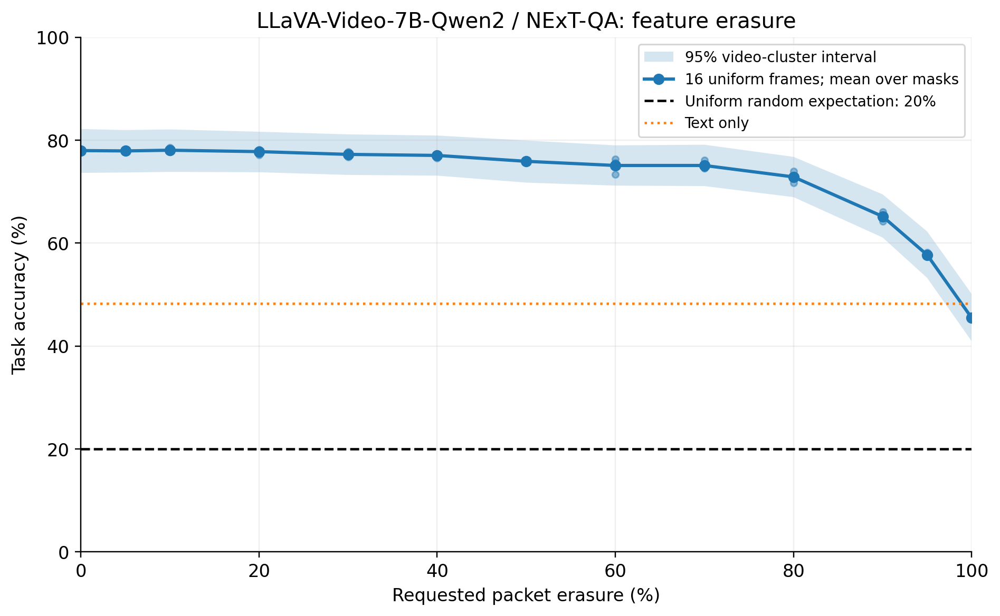

# NExT-QA 视频依赖与特征容错实验

**已完成：60视频、495题、48组条件，共23,760条模型回答。**
采用 `LLaVA-Video-7B-Qwen2`，语言模型线性层NF4双量化、BF16计算。
详细结论见 [实测报告](results/offline_20261012/report_findings_zh.md)，
完整统计见 [自动统计报告](results/offline_20261012/report_zh.md)。
本轮是离线中间特征擦除；尚未完成新模型的原版Testbed RTC/netem网络测试。

| 条件 | 准确率 |
|---|---:|
| 全视频等间隔16帧，无损 | 77.98% |
| 全视频等间隔64帧，无损 | 80.81% |
| 纯文本 | 48.28% |
| 错配视频16帧 | 38.79% |
| 独立高斯特征16帧 | 45.25% |
| 全零特征16帧 / 100%擦除 | 45.45% |
| 均匀随机选择的理论期望 | 20.00% |

**纯文本和错误视觉总体对照仍明显高于随机。**
更广的时间覆盖及更多不同帧有增益；打乱或倒放的总体差异区间跨零，
未确认明显的总体顺序敏感度。各项视频分组区间及成对比较见报告。
80%/90%/95%擦除时的平均准确率为72.86%/65.19%/57.71%。



[48组结果CSV](results/offline_20261012/condition_summary.csv) ·
[完整曲线CSV](results/offline_20261012/loss_curve.csv) ·
[逐题成对CSV](results/offline_20261012/paired_predictions.csv) ·
[原始模型回答](results/offline_20261012/predictions/)

23,760条回答独立计分，495题与官方CSV逐项匹配；
2,760个实际接收特征缓冲区及2,040份损伤掩码完成CPU独立重建核验。
暂停前14,163条回答逐字节保留，最终缺失、运行错误和格式无效均为0。
证据见 [独立核验](results/offline_20261012/independent_verification.json)。

目标是测量正常视觉相对纯文本的增益，区分帧数、时间覆盖和时间顺序的作用，
并测量视觉中间特征分包擦除后的任务准确率。预先约定见 [protocol.md](docs/protocol.md)。
各条件保留同一题目分母，缺失与无效答案计错，完整保留0%至100%擦除结果。
冻结的 [条件矩阵](configs/experiment.json) 共48组、23,760个固定答题槽位。
正常视觉测试1/4/16/64帧；容错曲线锚点为全视频等间隔16帧，
13个擦除率点、3组随机掩码，0%与100%确定端点各运行一次。
真实模型的[切分与生成核验](results/offline_20261012/pilot.json)已通过：
1/4帧完整路径与无损切分后的LM输入嵌入哈希及生成相同；
1/4/16帧的缓存分块生成与完整接收端生成相同；64帧已验证分块运行，
未声称进行未分块64帧对照。推理及分析的命令见 [复现说明](docs/reproduce.md)。

## 已固定的数据与基线

官方验证集共有4996题、570视频、每题5个选项。固定种子 `20261012`，
按视频分组选择60视频，保留全部495题；清单选择不读取答案标签或模型表现。
问题与选项保持官方顺序，标签不进入模型提示词。
60个视频均已完成镜像文件SHA-256核验；8009张缓存帧完成核验，
解码帧数、宽、高与官方标注一致。该核验不代替对官方原始压缩包的字节比对。

| 对照 | 答对/题数 | 准确率 |
|---|---:|---:|
| 均匀随机选择的理论期望 | — | 20.00% |
| 固定种子的一次随机选择 | 83/495 | 16.77% |
| 始终选择A（答案位置基线） | 121/495 | 24.44% |

一次随机选择可以偏离理论期望；不通过更换种子使其贴近20%。
实测纯文本、错配视频、全零及高斯特征总体对照均超出预设随机近似等效范围。
使用以视频为单位的区间，并将“无法拒绝差异”和“±5个百分点内等效”区分。
子集类型构成与全验证集不同，结果只代表固定子集。

- [固定题目、视频、错配映射](results/preparation/dataset_manifest.json)
- [随机预测逐题记录与答案位置统计](results/preparation/random_baseline.json)
- [官方标注的版本与哈希](results/preparation/annotation_provenance.json)
- [镜像视频版本与文件哈希](results/preparation/video_provenance.json)
- [原生帧索引、时间跨度与缓存核验](results/preparation/frame_cache_audit.json)

## 复现数据准备

在 Python 3.11+ 独立环境中执行，避免修改原有 Testbed 环境：

```sh
python -m pip install -r requirements-preparation.txt
python scripts/fetch_assets.py --assets assets --output results/preparation
python scripts/prepare_data.py --assets assets --output results/preparation --target 500 --seed 20261012 --workers 8 --download
python scripts/prepare_frames.py --assets assets --manifest results/preparation/dataset_manifest.json --provenance results/preparation/video_provenance.json --output results/preparation/frame_cache_audit.json
python scripts/random_baseline.py --manifest results/preparation/dataset_manifest.json --output results/preparation/random_baseline.json
python -m unittest discover -s tests -v
```

推理器输出逐行JSON，每行至少包含 `question_id` 与原始 `raw_response`。
计分器保留缺失、拒绝未知或重复问题ID，并支持同题成对比较：

```sh
python scripts/score_results.py --manifest results/preparation/dataset_manifest.json --predictions results/offline_20261012/predictions/uniform_16.jsonl --reference results/offline_20261012/predictions/text_only.jsonl --output uniform16_summary.json
```

此命令可直接从已公开的原始回答重新计分，不需要模型权重或GPU。

标注来自固定提交的官方仓库。视频使用固定版本的第三方镜像，并逐文件验证LFS
SHA-256；未核验它们与官方 Google Drive 压缩包字节相同。
全部所选视频都必须取得，不根据可下载性、模型表现或问题难度替换样本。
原生帧按解码索引保存为无模型缩放的RGB PNG，保留PTS时间、FPS和哈希。
连续中心窗口与覆盖全视频的等间隔帧分别缓存，帧数为1/4/16/64；短视频不重复补帧。
在本子集中，连续4帧的时间跨度中位数为0.1001秒，连续64帧为2.1021秒，
等间隔64帧为33.6903秒。它们的时间覆盖不同，不能单凭帧数解释任务变化。

模型权重、视频、图片缓存、抓包与临时信令留在本地，不进入公开仓库。
中间特征的离线擦除结果和原版 Testbed 的 RTC/netem 网络结果将分别记录。
已完成离线池化特征切分适配；目前未运行新的RTC测量。

## 来源

NExT-QA: Xiao, Junbin; Shang, Xindi; Yao, Angela; Chua, Tat-Seng.
*NExT-QA: Next Phase of Question-Answering to Explaining Temporal Actions*. CVPR 2021,
pp. 9777–9786. [官方仓库](https://github.com/doc-doc/NExT-QA)。
该仓库MIT许可证保留于 [docs/licenses/NExT-QA.txt](docs/licenses/NExT-QA.txt)。

模型采用 [LLaVA-Video-7B-Qwen2](https://huggingface.co/lmms-lab/LLaVA-Video-7B-Qwen2)，
固定权重revision `013210b3aff822f1558b166d39c1046dd109520f`；
官方运行源码revision `bce12e479bc4dfee2b9c50c88137b01ff51bd483`。
本机8GB显存采用语言模型线性层NF4双量化、BF16计算，
视觉塔、投影器、词嵌入与输出头不做4-bit量化。

[LLaVA-Video 官方介绍](https://llava-vl.github.io/blog/2024-09-30-llava-video/)
公开的训练混合包含NExT-QA。这说明数据集域有重合，不能由此推断验证集标签已泄漏，
也不能将其表现描述为从未见过该数据集的泛化。
