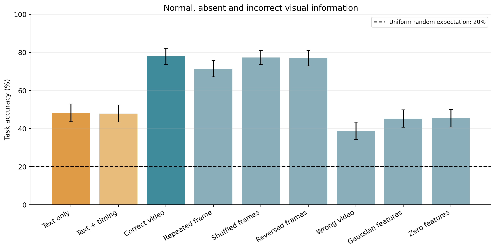
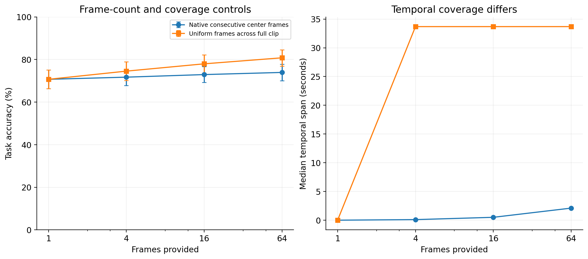

# LLaVA-Video / NExT-QA 实测结论

已完成固定60视频、495题、48组条件，共23,760次回答。本机RTX3070 8GB，LLaVA-Video-7B-Qwen2语言模型线性层NF4双量化、BF16计算；这是该量化配置和固定子集的成绩，不能当作官方BF16全验证集成绩。

**结果：视觉有明显增益，多帧内容与时间覆盖有作用，但纯文本和完全错误视觉仍远高于随机。整体准确率没有显示出明确的帧顺序依赖。**

**范围：离线中间特征分包擦除。本轮未执行新的原版Testbed RTC/netem network profile测试。**

## 纯文本及错误视觉是否匹配随机选择

| 条件 | 答对/495 | 准确率 | 95%视频分组区间 | 随机近似等效用90%区间 |
|---|---:|---:|---:|---:|
| uniform_16 | 386/495 | 77.98% | [73.64, 82.16]% | [74.36, 81.52]% |
| uniform_64 | 400/495 | 80.81% | [76.92, 84.52]% | [77.65, 83.94]% |
| text_only | 239/495 | 48.28% | [43.62, 53.03]% | [44.38, 52.22]% |
| text_timing_16 | 237/495 | 47.88% | [43.48, 52.44]% | [44.11, 51.72]% |
| wrong_video_16 | 192/495 | 38.79% | [34.30, 43.40]% | [34.98, 42.68]% |
| gaussian_16 | 224/495 | 45.25% | [40.73, 49.90]% | [41.41, 49.15]% |
| zero_16 | 225/495 | 45.45% | [40.92, 50.11]% | [41.60, 49.42]% |

五选一均匀随机的理论期望为20%，预设±5个百分点近似等效区间为[15%,25%]。纯文本、错视频、独立高斯特征、全零特征四个总体对照的90%区间均完整高于25%，**均不匹配随机基础性能**。固定种子的一次随机选择83/495（16.77%），始终选A为121/495（24.44%）；它们与模型输出分开记录。

16帧正常视觉相对纯文本提高29.70个百分点，成对95%区间为[24.85, 34.48]个百分点。换数据集没有消除问题及选项提供的语言线索。错视频会误导答案，而全零/高斯并不会删除问题与选项；它们也保留视觉结构token和目标时间文字。因此“视觉完全错误”不等于“随机选择选项”。本实验没有单独量化各类语言线索的因果贡献。

## 连续多帧、覆盖范围与帧顺序

| 帧数 | 原生FPS连续中心帧 | 覆盖全视频等间隔帧 |
|---:|---:|---:|
| 1 | 70.71% | 70.71% |
| 4 | 71.72% | 74.55% |
| 16 | 72.93% | 77.98% |
| 64 | 73.94% | 80.81% |

连续4/16/64帧跨度中位数分别为0.1001/0.5005/2.1021秒；全视频等间隔帧覆盖约33.69秒，4/16/64帧覆盖相同起止时刻。NExT-QA问题针对整段视频，没有问题提出时间；连续窗口预先固定在视频中心，未按答案选择事件窗口。

| 比较（左减右） | 差值，百分点 | 成对95%区间，百分点 |
|---|---:|---:|
| 全视频16帧 − 连续中心16帧 | 5.05 | [1.03, 9.00] |
| 全视频64帧 − 全视频4帧 | 6.26 | [2.84, 9.84] |
| 连续64帧 − 中心单帧 | 3.23 | [-0.19, 6.42] |
| 不同16帧 − 中心单帧重复16次 | 6.46 | [2.25, 10.64] |
| 原顺序16帧 − 打乱16帧 | 0.61 | [-1.64, 2.83] |
| 原顺序16帧 − 倒放16帧 | 0.81 | [-1.36, 2.97] |

更广的时间覆盖和更多不同帧提供了增益。连续64帧相对单帧的总体区间仍跨零；不能据此确认该固定中心窗口的总体增益。原顺序、打乱、倒放分别为77.98%、77.37%、77.17%，成对差异区间跨零，未确认总体顺序敏感度；这也不能证明模型完全忽略顺序。

### 问题类型

| 条件 | C因果（251题） | T时间（169题） | D描述（75题） |
|---|---:|---:|---:|
| text_only | 51.00% | 46.15% | 44.00% |
| native_center_1 | 74.90% | 61.54% | 77.33% |
| native_center_64 | 73.71% | 71.01% | 81.33% |
| uniform_16 | 78.09% | 72.78% | 89.33% |
| uniform_64 | 80.48% | 78.11% | 88.00% |
| repeat_16 | 73.31% | 64.50% | 81.33% |
| shuffle_16 | 77.69% | 71.01% | 90.67% |
| reverse_16 | 78.09% | 69.82% | 90.67% |
| wrong_video_16 | 36.25% | 43.20% | 37.33% |
| zero_16 | 47.81% | 46.75% | 34.67% |

T类的成对补充分析如下。这些类型内比较及下面的损伤差异区间在推理完成后汇总，属于探索性结果，未校正多重比较；全部8个细分类结果见analysis.json。

| T类比较 | 差值，百分点 | 95%视频分组区间，百分点 |
|---|---:|---:|
| native_center_64 − native_center_1 | 9.47 | [2.78, 16.09] |
| uniform_16 − repeat_16 | 8.28 | [0.58, 16.22] |
| uniform_16 − shuffle_16 | 1.78 | [-1.75, 5.26] |
| uniform_16 − reverse_16 | 2.96 | [-1.31, 7.41] |

T类中，连续64帧相对单帧提高9.47个百分点，区间未跨零；但打乱和倒放的差异区间仍跨零。多帧对时间类题目有帮助，并不直接证明依赖正确时间顺序。

## 分包擦除容错曲线

切分点为官方视觉投影和空间池化之后、网格换行token之前。16帧池化特征以小端F32传输，每包1080字节特征负载（沿用原Testbed负载预算，非1500字节净特征），每个视频缓冲区44,957,696字节、41,628包。缺包对应位置全部置零。本轮只离线生成IID随机擦除掩码，没有模拟RTC重传、突发丢包、拥塞或真实包头。

| 请求擦除率 | 平均准确率 | 相对无损差值，百分点 | 成对95%区间，百分点 |
|---:|---:|---:|---:|
| 0.00% | 77.98% | 0.00 | [0.00, 0.00] |
| 5.00% | 77.91% | -0.07 | [-0.65, 0.50] |
| 10.00% | 78.05% | 0.07 | [-0.78, 0.96] |
| 20.00% | 77.78% | -0.20 | [-1.45, 1.05] |
| 30.00% | 77.24% | -0.74 | [-2.36, 0.84] |
| 40.00% | 77.04% | -0.94 | [-2.65, 0.72] |
| 50.00% | 75.89% | -2.09 | [-4.22, 0.00] |
| 60.00% | 75.08% | -2.90 | [-5.01, -0.78] |
| 70.00% | 75.08% | -2.90 | [-5.54, -0.21] |
| 80.00% | 72.86% | -5.12 | [-8.23, -2.02] |
| 90.00% | 65.19% | -12.79 | [-16.77, -8.87] |
| 95.00% | 57.71% | -20.27 | [-24.79, -15.62] |
| 100.00% | 45.45% | -32.53 | [-37.65, -27.45] |

0%–40%擦除的点估计变化较小，50%–70%仍约75%–76%；80%为72.86%，90%为65.19%，95%为57.71%，100%为45.45%。下降在本次高擦除区间更明显，但没有预先定义或估计统一的“拐点”。50%点的成对区间上界约为零，不能把数值舍入误差视作明确阈值。保留全部0%–100%点及小幅非单调变化，不裁掉端点或做单调拟合。100%端点仍高于随机，意味着高损伤区间存在较高的非视觉任务基础性能。

每个中间擦除率使用3组固定掩码，0%/100%确定端点各运行一次。同视频各题共享掩码；不同擦除率采用嵌套掩码。区间按视频分组，先对同题跨掩码取平均，没有把3份答案当成1485个独立问题。仅3组掩码不足以充分刻画任意网络环境的随机性，不能外推到实际RTC network profile。

## 核验、复现与边界

- 23,760条回答独立计分；495题的问题、选项和标签与固定官方CSV逐项匹配。
- 从BF16源特征独立重建2760个接收缓冲区、2040份损伤掩码，缺包数量、置零字节与实际接收SHA-256全部一致。这证明所声明损伤进入了接收端，不单凭准确率曲线推断容错。
- 昨晚暂停前14,163条回答逐字节保留；恢复只补未尝试槽位。最终缺失0、不可用0、运行错误0、格式无效0。
- 真实模型无损切分和缓存生成一致性边界见pilot.json。64帧验证了分块可运行，没有声称完成未分块64帧完整路径对照。
- LLaVA-Video公开训练混合包含NExT-QA；这是数据集域有重合的评测，不证明验证集泄漏，也不声称数据集未见泛化。
- 子集保持视频成组，按固定种子及问题类型选取；不是完整验证集，也没有对视频平均等权计分。视频镜像SHA核验通过，未与官方Google Drive压缩包做逐字节比对。
- 所有区间为10,000次固定种子视频分组bootstrap，主要比较按预设方法汇总。未做多重比较校正，不构成实际网络部署的容错验证。

## 文件

- [完整自动统计报告](report_zh.md)、[48组数值](condition_summary.csv)、[13点曲线及实际擦除率](loss_curve.csv)
- [逐题成对CSV](paired_predictions.csv)、[原始答案](predictions/)、[完整统计及类型分组](analysis.json)
- [独立核验](independent_verification.json)、[补充成对分析](supplementary_analysis.json)、[曲线成对差异CSV](loss_paired_differences.csv)
- [固定实验方案](../../configs/experiment.json)、[预设协议](../../docs/protocol.md)、[复现命令](../../docs/reproduce.md)

来源：[NExT-QA官方仓库](https://github.com/doc-doc/NExT-QA)、[LLaVA-Video-7B-Qwen2](https://huggingface.co/lmms-lab/LLaVA-Video-7B-Qwen2)、[LLaVA-Video官方介绍及训练混合](https://llava-vl.github.io/blog/2024-09-30-llava-video/)。
